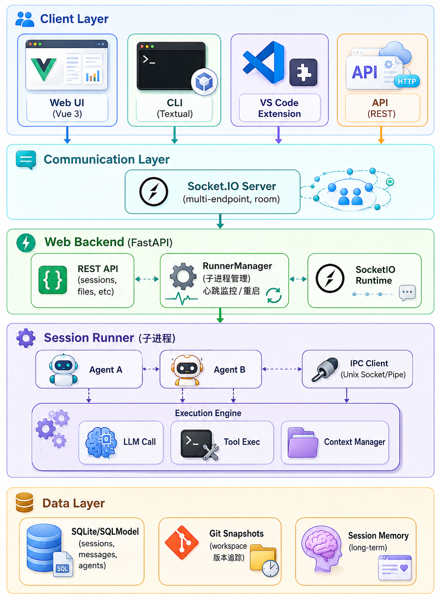

# Broca — 轻量级 Agent 框架

<div align="center">

**一个可扩展的智能体框架，支持多端实时交互**
· 组件化插件架构 · 多 LLM 供应商 · 多智能体编排 · 子进程隔离 · 跨会话记忆

</div>

### Web Demo


### Vscode Demo


### TUI Demo


---

## 为什么选择 Broca

- **模块化装配**：21 个组件接口（ABC）+ `ComponentRegistry` 统一装配，支持作用域、三级优先级解析与 entry point 惰性加载
- **非阻塞执行**：Strategy + Hook 架驱动的执行引擎，可在 Agent 运行中追加用户输入或 Agent 通知，无需等待当前 turn 结束
- **多智能体编排**：Pipeline / Supervisor-Worker / Round-Table / Composite 四种拓扑，有向图驱动、共享黑板、并行扇出、条件跳转与人在环路
- **多端实时交互**：基于 Socket.IO，Web / TUI / VS Code 共享同一套消息通道，投递 ACK 保证线序
- **安全隔离**：每个会话运行在独立子进程，心跳监控 + IPC 多路复用；基于 Git Step 级快照的撤销/重做
- **长期记忆**：会话短期压缩 + 跨会话持久化记忆（独立子 Agent 提取），Skill 可由 Agent 自主创建与进化
- **媒体按需物化**：图片/文件以轻量 `ref://` 引用持久化，发往 LLM 前才物化为 base64 或 provider `file_id`

## 快速开始

环境要求：Python ≥ 3.12、Node.js ≥ 18、pnpm（或 npm）、nginx（生产部署）。

```bash
git clone https://github.com/lawRossi/Broca && cd broca
sh scripts/install.sh          # 一键安装到 ~/.broca/
# 首次使用需填写 ~/.broca/configs/llm_config.json 中的 API Key
broca service start            # 启动 nginx + backend + frontend
```

访问 `http://localhost:7001`，或运行 `broca` 启动终端 TUI。

> 完整安装目录结构、服务管理、CLI 命令、客户端安装与部署架构见 [快速开始与部署](docs/getting-started.md)。

## 架构一览



核心思路：**薄编排器 + 可替换组件**。所有核心能力（LLM 客户端、工具执行、通信、权限、压缩、快照、编排等）都通过 `ComponentRegistry` 按作用域装配；执行引擎只负责 turn/step 生命周期，重试、工具并发、快照、记忆分别由 Strategy 与 Hook 承担。`Agent.create()` 是组合根。

```
Agent ──→ LoopEngine (薄编排) ──→ LLM Strategy → Tool Strategy
                    │
                    └──→ Hooks: Snapshot → Broadcast → DeadLoop → Compression → Cleanup
```

| 模块 | 能力 |
|------|------|
| 核心运行时 | Agent 装配、循环引擎、工具系统、会话/子进程隔离、上下文与记忆、快照撤销 |
| 多智能体编排 | 4 种拓扑、有向图路由、共享黑板、HITL、图校验 |
| Skill 与命令 | Markdown 定义技能、Agent 自主创建/进化、`/` 快捷命令 |
| 高级特性 | System One 决策组件、Agent 间通信、媒体按需物化 |
| 客户端 | Vue 3 Web、Textual TUI、VS Code 扩展 |
| 配置 | LLM / 决策 / Agent / MCP / 运行环境 |

## 文档导航

| 文档 | 内容 |
|------|------|
| [快速开始与部署](docs/getting-started.md) | 环境要求、一键安装、服务管理、CLI、部署架构、TUI / VS Code 安装 |
| [核心架构与运行时](docs/architecture.md) | 组件化插件架构、技术栈、Agent/引擎/工具/会话/通信/Runner/记忆/快照、设计模式 |
| [多智能体编排](docs/orchestration.md) | 4 种拓扑的 YAML 示例、有向图模型、黑板、路由、循环控制、Demo |
| [Skill 与命令系统](docs/skills-and-commands.md) | Skill 定义/来源管理/进化、命令架构与可用命令 |
| [决策、通信与媒体](docs/advanced-features.md) | System One 决策、`communicate` 三种模式、`ref://` 媒体物化 |
| [前端与客户端](docs/clients.md) | Web / TUI / VS Code 三端能力与目录 |
| [配置参考](docs/configuration.md) | configs.json、LLM、媒体、决策、Agent、MCP、环境变量、端口、环境隔离 |
| [插件开发指南](docs/plugin-development-guide.md) | 组件接口、作用域、注册方式、开发示例、信任边界 |
| [项目结构](docs/project-structure.md) | 完整目录树与各模块职责 |
| [开发环境与 CI](docs/dev-worktree-setup.md) · [CI 环境变量](docs/ci-environment-variables.md) | Worktree 隔离、端口方案、CI 配置 |

## 常用命令速查

| 命令 | 说明 |
|------|------|
| `broca` / `broca tui` | 启动 TUI（默认行为） |
| `broca web [frontend\|backend]` | 启动 Web 开发服务 |
| `broca service start/stop/restart/status` | 管理生产服务 |
| `broca worktree create/delete/list` | 管理 git worktree + 会话 |
| `broca snapshot gc` | 清理孤儿快照 |
