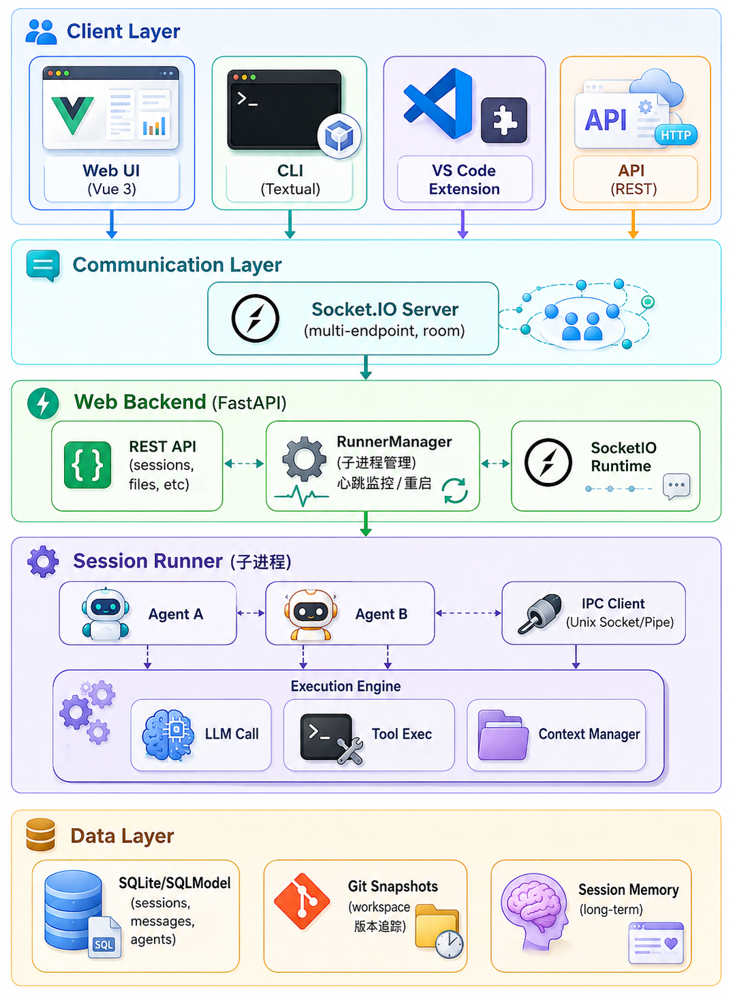

> [← 返回 README](../README.md)

# 核心架构与运行时模块



## 组件化插件架构

Broca 采用**组件化插件架构**，所有核心功能模块均通过 `ComponentRegistry` 统一管理：

- **21 个组件接口**（ABC），涵盖 LLM 客户端、工具执行器、通信器、权限提供者、上下文压缩器、Agent 间通信、循环引擎等；另有 `LLMStrategy` / `ToolExecutionStrategy` / `LoopHook` 三个策略/钩子接口参与装配
- **4 种作用域**：`singleton`（进程级共享）、`per-agent`（每个 Agent 独立实例）、`per-session`（会话级）、`transient`（每次新建）
- **3 级解析优先级**：`override`（配置/手动）> `discovered`（entry point 插件）> `default`（内置实现）
- **惰性加载**：插件模块仅在 `resolve()` 时才被 import，未使用的插件不进入 `sys.modules`

```python
# 自定义组件示例：替换默认工具执行器
from broca.components.tool_executor import ToolExecutionOutcome, ToolExecutor

class MySandboxExecutor(ToolExecutor):
    async def initialize(self, tool_mapping, permission_provider, config, communicator):
        ...  # 注入运行时依赖

    def get_permission(self, tool_name: str) -> str:
        ...  # "allow" | "ask" | "forbidden"，引擎据此划分串行/并发

    def is_readonly_tool(self, tool_name: str) -> bool:
        ...  # 供快照决策使用

    async def execute_tool(self, tool_name, arguments, tool_call_id,
                           context, tool, allowed_tools=None) -> ToolExecutionOutcome:
        ...
```

在 `.broca/components.json` 中配置 override 即可替换默认实现；详细开发指南见 [插件开发指南](plugin-development-guide.md)。


## 技术栈

### 后端核心

| 技术　　　　　　　　　　　　　　　　　　　　　　　　　　　 | 用途　　　　　　　　　　　 |
| ------------------------------------------------------------| ----------------------------|
| Python　　　　　　　　　　　　　　　　　　　　　　　　　　 | 主语言　　　　　　　　　　 |
| [litellm](https://github.com/BerriAI/litellm)　　　　　　　| 统一 LLM API 接入　　　　　|
| [typesafe-sdk](https://github.com/typesafe-ai/typesafe-sdk-python) | 决策模型 SDK（System One API） |
| [SQLModel](https://sqlmodel.tiangolo.com/)　　　　　　　　 | ORM + 数据建模　　　　　　 |
| [aiosqlite](https://github.com/omnilib/aiosqlite)　　　　　| 异步 SQLite　　　　　　　　|
| [python-socketio](https://python-socketio.readthedocs.io/) | 实时通信　　　　　　　　　 |
| [aiohttp](https://docs.aiohttp.org/)　　　　　　　　　　　 | 异步 HTTP　　　　　　　　　|
| [Jinja2](https://jinja.palletsprojects.com/)　　　　　　　 | 模板渲染（编排提示词模板） |
| [APScheduler](https://apscheduler.readthedocs.io/)　　　　 | 任务调度　　　　　　　　　 |
| [GitPython](https://gitpython.readthedocs.io/)　　　　　　 | Git 操作　　　　　　　　　 |
| [Playwright](https://playwright.dev/python/)　　　　　　　 | Web 抓取　　　　　　　　　 |
| [MCP SDK / FastMCP](https://modelcontextprotocol.io/)　　 | MCP 工具接入　　　　　　　 |
| [Pillow](https://pillow.readthedocs.io/)　　　　　　　　　 | 图片压缩（媒体物化）　　　 |
| [boto3](https://boto3.amazonaws.com/v1/documentation/api/latest/index.html) / [httpx](https://www.python-httpx.org/) | S3 兼容存储读取 / Files API 上传 |

### Web 后端

| 技术　　　　　　　　　　　　　　　　　　　 | 用途　　　　　　　 |
| --------------------------------------------| --------------------|
| [FastAPI](https://fastapi.tiangolo.com/)　 | REST API 框架　　　|
| [Uvicorn](https://www.uvicorn.org/)　　　　| ASGI 服务器　　　　|
| [Supabase](https://supabase.com/)　　　　　| 用户认证与文件上传 |
| [Alembic](https://alembic.sqlalchemy.org/) | 数据库迁移　　　　 |

### 前端

| 技术 | 用途 |
|------|------|
| [Vue 3](https://vuejs.org/) | 前端框架 (Composition API) |
| [TypeScript](https://www.typescriptlang.org/) | 类型安全 |
| [Vite](https://vitejs.dev/) | 构建工具 |
| [Pinia](https://pinia.vuejs.org/) | 状态管理 |
| [Tailwind CSS](https://tailwindcss.com/) | 样式 |
| [Socket.IO Client](https://socket.io/) | 实时通信 |

### TUI 终端界面

| 技术　　　　　　　　　　　　　　　 | 用途　　　　　 |
| -----------------------------------| ----------------|
| Python　　　　　　　　　　　　　　| 开发语言　　　 |
| [Textual](https://textual.textualize.io/) | 终端 UI 框架 |
| [Rich](https://rich.readthedocs.io/) | 富文本渲染　 |
| Socket.IO Client　　　　　　　　　| 实时通信　　　 |

### VS Code 扩展

| 技术　　　　　　 | 用途　　 |
| ------------------| ----------|
| TypeScript　　　 | 开发语言 |
| VS Code API　　　| 扩展框架 |
| Socket.IO Client | 实时通信 |


## 核心模块

### 1. 核心 Agent 层

**核心文件**: `broca/agent.py`, `broca/agent_manager.py`, `broca/agent_configs.py`

Agent 是系统的核心执行单元，每个 Agent 包含：

- **LLM Client**: 统一封装对不同 LLM 提供商的调用（流式/非流式），并在发送前做媒体按需物化
- **Tool 集合**: 可配置的工具列表，支持内置工具、自定义工具和 MCP 工具
- **Context**: 管理对话历史和 system prompt 的组装
- **Communicator**: 通过 Socket.IO 实现多端消息收发
- **AgentMessenger**: Agent 间通信组件（request / notify / delegate）
- **Compressor**: 短期会话记忆提取 + 上下文压缩
- **Permission Provider**: 用户交互式权限管理
- **Revert Service**: 撤销/重做支持

Agent 有三种运行状态：`idle`、`running`、`disconnected`。每个 Agent 拥有独立的 LLM Client 实例和统计数据追踪（token 用量、调用次数等）。

`Agent.create()` 是组合根（Composition Root），从 `ComponentRegistry` 按作用域解析并装配上述全部组件；为了打破 `Agent ↔ LoopEngine` 的循环引用，传给引擎的是轻量代理 `AgentReferenceAdapter`（`broca/agent_reference.py`）。

**AgentFactory**（单例）负责：
- 从配置文件加载 Agent 配置（YAML + Markdown 格式）
- 创建/恢复/缓存 Agent 实例
- 管理会话内的 Agent 集合

### 2. 循环执行引擎

**核心文件**: `broca/loop_engine/`（包），接口定义在 `broca/components/loop_engine.py`、`llm_strategy.py`、`tool_strategy.py`、`loop_hook.py`

引擎已从单文件重构为 **Strategy + Hook + 薄编排器** 架构：`DefaultLoopEngine`（`broca/loop_engine/engine.py`）只负责 turn/step 生命周期、Hook 调度顺序、数据库持久化和广播回调；具体策略与副作用全部下沉：

| 分类 | 实现 | 职责 |
|------|------|------|
| LLM 策略 | `RetryLLMStrategy`（`strategies/retry_llm.py`） | 重试/限流/超时/空响应处理、流式聚合与 chunk 回调 |
| 工具策略 | `SerialToolStrategy` / `ParallelToolStrategy`（`strategies/*.py`） | 串行执行；或按权限分区——`ask` 类工具串行、其余并发（受 `max_parallel_tools` 信号量约束），结果保持原顺序 |
| Hook | `SnapshotHook` | step 快照、patch、turn 级 `changed_files`；由 `enable_snapshot_tracking` 门控 |
| Hook | `LifecycleBroadcastHook` | `turn_start` / step 标记 / `turn_end` / 错误广播，仅交互模式启用 |
| Hook | `DeadLoopHook` | 最近 N 个工具调用签名相同时标记 `DEAD_LOOP`（`dead_loop_window`，默认 3） |
| Hook | `CompressionMemoryHook` | 等待式上下文压缩 + fire-and-forget 持久化记忆提取 |
| Hook | `ContextCleanupHook` | `ABORTED` 时移除上下文中残留的助手工具调用消息 |

Hook 顺序固定为 **snapshot → communicator → dead_loop → compression → context_cleanup**；子 Agent 使用精简 Hook 集（无快照/广播）。所有 Hook 异常都被捕获，不会中断主循环。

**单步流程**：`LLM 调用 → token 统计 → on_step_start → 持久化 STEP_START → 保存助手消息 → flush chunks → 工具执行 → 处理结果 → on_step_end → 持久化 STEP_END → on_post_step → 终态检查`；turn 结束时依次触发 `on_turn_end → 保存 TURN_END → on_turn_finalized`。

**非阻塞执行模式**（默认开启）：

- 配置项 `configs/configs.json` → `execution.execution_mode`（默认 `"non_blocking"`，设为 `"blocking"` 可回退）；Web / VS Code 设置面板也可切换
- `Agent.start()` 通过 `MessageSource`（`_Drainer`）在下一次 step 前非阻塞地排空 `USER_MESSAGE` 与 `AGENT_NOTIFY`，用 `_inject_user_message()` 注入上下文；终态（含 `COMPLETED`）不排空，消息留到下一 turn
- 不传 `message_source` 时走传统阻塞路径，行为兼容旧版本

**工具注入消息**（`tool_injected_messages.py`）：工具的 `extra_context_messages`（如 `read_image` 产生的多模态图片消息）以 `data["tool_injected"] = True` 持久化，并在**该 step 全部工具结果落库之后**才追加到上下文，避免 `user` 消息插在助手 `tool_calls` 与连续 `tool` 结果之间导致下一轮 LLM 调用出错。

执行状态枚举：`RUNNING`、`PENDING`、`COMPLETED`、`ERROR`、`ABORTED`、`SKIPPED`、`LIMIT_EXCEEDED`、`DEAD_LOOP`

### 3. 工具系统

**核心文件**: `broca/tools/tool_manager.py`, `broca/tools/tool.py`

**自动发现机制**：ToolManager（单例）启动时自动扫描 `broca/tools/` 目录下的所有 Tool 子类并注册。每类工具对应一个 Python 文件，继承自 `Tool` 基类。

**内置工具**：

| 类别 | 工具 |
|------|------|
| **文件/搜索** | `read_file`, `edit_file`, `write_file`, `glob`, `grep`, `list_dir`, `tree_dir`, `file_mtime`, `read_image` |
| **执行/调度** | `bash`, `process_management`, `cron` |
| **网络/交互** | `web_fetch`, `web_search`, `ask_user`（向用户提问）, `communicate`（向其他 Agent 发消息） |
| **任务/黑板** | `task_management`, `todo_management`, `read_blackboard`, `write_blackboard`, `list_blackboard`, `blackboard_changes`, `delete_blackboard` |
| **Skill / MCP** | `load_skill`, `skill_manage`，以及 `mcp_{server}_{tool}` 形式的 MCP 工具 |

- 只读性以 `Tool.is_readonly` 属性为准；`ToolManager.READONLY_TOOLS` 仅作为未注册工具（自定义/MCP）按名称判定的兼容回退，二者由测试保证一致
- `bash` 工具默认执行 Shell 安全扫描（tree-sitter），可通过 Agent 配置 `bash_security_check: false` 关闭
- 工具名必须唯一，内置工具与自定义工具不可重名
- 支持 MCP（Model Context Protocol）工具加载，stdio / SSE 两种传输
- 支持工作区自定义工具（`{workspace}/.broca/tools.py`）
- 允许配置 Agent 可用的工具白名单

### 4. 会话管理

**核心文件**: `broca/session/`

会话（Session）是对话的基本单元，每个会话包含：

- **Session**: 会话元信息（描述、工作区、创建时间）
- **Turn**: 对话轮次（一次用户输入 + Agent 完整的回应过程）
- **Message**: 消息（`user_message` / `agent_response` / `agent_error` / `system_message` / `tool_call`，以及 `agent_query` / `user_answer` / `agent_request` / `agent_request_response` / `agent_notify` / `agent_delegate` / `turn_start` / `turn_end` / `step_start` / `step_end`）
- **Agent / AgentConfig**: Agent 实例及其配置持久化
- **ScheduledJob**: 定时任务（由 `broca/scheduler.py` 管理）

**数据库**：基于 SQLModel + aiosqlite 的异步 SQLite 数据库，支持 Alembic 迁移。

**消息模型**支持：
- 序列号排序
- 截断标记（`is_truncated`，被会话记忆压缩替代的历史消息）
- 过期标记（`is_expired`，清除上下文时标记的消息，读取时以占位符呈现）
- 工具注入标记（`data["tool_injected"] = true`，如 `read_image` 产生的图片消息；明细/搜索接口返回，前端简洁模式过滤）
- Step 级快照关联

**RevertService** 提供 undo/redo 能力，基于 Git 快照比对实现文件级变更回滚。

**SessionCleanupService**（`broca/session/cleanup_service.py`）在会话删除时统一清理：`.broca/{session_id}/` 目录、runner 日志、媒体缓存、孤儿定时任务，并在该工作区再无会话时删除 Git 快照仓库。

### 5. 通信层

**核心文件**: `broca/communication/socketio_server.py`

SocketIOServer 是一个多端通信服务器，支持：

- **多种客户端类型**: browser、CLI、VSCode、browser_plugin
- **消息路由**: 支持直接发送、订阅广播、房间广播
- **事件系统**: 可注册自定义事件处理器（connect、disconnect、message 等）
- **线程安全**: 使用 asyncio.Lock 保护共享状态
- **投递 ACK**: `communicator.send()` 等待 socketio callback 返回 `{"status": "routed"}` 才算投递成功（2s 超时），避免消息丢失与自回显

通信消息包含完整的元信息：消息类型、角色、发送者/接收者、订阅频道、错误码等。Agent 间通信的四种消息类型（`agent_request` / `agent_request_response` / `agent_notify` / `agent_delegate`）也走同一通道，详见 [Agent 间通信](advanced-features.md#agent-间通信)。

### 6. Session Runner

**核心文件**: `broca/session_runner/`

将每个会话隔离在独立子进程中运行，提供：

- **RunnerManager**（Web 进程中的单例，即 `IPCSessionRunner`）：管理子进程生命周期
  - 启动/停止/重启会话进程（判活三因子：PID + `create_time` + cmdline 含模块标识与 session_id，防 PID 复用误杀）
  - 心跳监控（默认 15s 检查，45s 超时，`stop_requested` 状态机区分优雅停止/崩溃）
  - 数据库持久化与恢复（启动时恢复活跃会话）
  - 并发限制（默认最大 10 个并发）
  - 事件系统（session_started / session_stopped / session_crashed）

- **分层架构**（父进程侧协作对象，替代原 God Class）：
  - `RunnerRepository`：DB 读写层，跨 session 批量落库（N session 心跳 → 1 commit）
  - `HeartbeatMonitor`：纯监控策略（存活判定 + 崩溃重启决策，不直接写库）
  - `IPCPoller`：单线程多路复用收所有子进程 IPC 消息，N session 只加 1 条线程（O(1)）
  - `MessageRouter`：实例级路由，把命令/响应/事件分发给对应 handler
  - `backpressure`：IPC 队列背压，满时按策略丢弃并计数（`get_stats().dropped_events`）

- **IPC 通信**: 基于 Unix Socket（Linux/macOS）或 Named Pipe（Windows）
  - 控制命令：execute、abort、shutdown、status、get_stats
  - 事件通知：ready、heartbeat、status_change、error、completed

- **Runner 子进程**: 加载会话 → 连接 Socket.IO → 启动 Agent 消息循环 → 定期心跳
- **用户命令环境隔离**（`broca/utils/env.py`）：执行 bash / 进程管理 / 定时任务前剥离 runner 内部标记变量、还原 supervisor 原始环境，并优先适配工作区 venv

心跳/背压等参数集中在 `configs/configs.json` 的 `execution` 段（`runner_heartbeat_interval`、`runner_heartbeat_check_interval`、`runner_heartbeat_timeout`、`runner_ipc_queue_size` 等）。

### 7. 上下文与记忆

**核心文件**: `broca/context.py`, `broca/context_compressor.py`, `broca/components/compressor_context_factory.py`, `broca/persistent_memory/`

> 原 `broca/session_memory/` 模块已合并进 `broca/context_compressor.py`，`SessionMemoryManager` 类不再存在；具体实现类是 `SessionMemoryCompressor`（兼容别名 `ContextCompressor`）。

**Context** 负责：
- 组装 system prompt（角色定义、环境信息、Skills、配置文件、记忆、用户画像）
- 管理对话历史与数据库 message_id 的映射
- 支持从数据库重建历史（过滤被截断/过期的消息）
- 在 Abort 时自动截断最后一次含工具调用的 Assistant 消息

**会话上下文压缩**（统一"提取 + 压缩"流程）：
- 由 `SessionMemoryCompressor` 统一编排：token 超阈值时先由子 Agent 提取记忆，再截断早期对话释放上下文窗口
- **触发阈值**：`compact_config.session_trunc_threshold`（默认 250000）与 `session_trunc_percentage`（默认 0.5，钳制到 `[0.05, 1.0]`），有效阈值取 `min(绝对阈值, LLM context_window × 百分比)`；未配置 context window 时用绝对阈值
- **保留边界**：`compact_config.keep_steps`（默认 **8**）——保留当前进行中 turn 内最近 N 个 step，**绝不跨 turn 截到上一轮**
- **唯一门控**：`enable_context_compression`（`AgentConfig` 上，默认 false）；由 `CompressionMemoryHook` 在每步后调用，`/compact` 命令可强制触发
- 产物：压缩统计 `CompressionStats` 与状态 `SessionMemoryState`

**Session Memory**（会话短期记忆）：
- 在上下文中注入当前会话的历史摘要
- 每个 Agent 使用**独立记忆文件**，避免多 Agent 并发写入互相覆盖
- 后台子 Agent（角色 `session_memory_manager`）用将被压缩的旧消息提取关键信息并更新 snapshot
- 记忆文件（agent 级路径）：
  - `.broca/{session_id}/{agent_id}/session-memory_latest.md` —— 提取中的 snapshot
  - `.broca/{session_id}/{agent_id}/session-memory.md` —— 冻结记忆（frozen），注入 system prompt

**Persistent Memory**（跨会话持久化记忆）：
- 采用**独立子 Agent 提取**模式，管理器为 `SubAgentMemoryManager`（`broca/persistent_memory/manager.py`）
- 每条记忆独立存储为 `.md` 文件，带 YAML frontmatter（含 `name`、`description`、`type`、`created`、`updated`）
- `MEMORY.md` 做索引，始终加载到系统提示词中，含**新鲜度标注**和**老化总览警告**
- 四种记忆类型：`user`（用户画像）、`feedback`（行为指导）、`project`（项目上下文）、`reference`（外部系统指针）
- 两种提取方式：
  - **自动提取**：`persistent_memory_config.auto_extract: true` 时按阈值（消息数/步数）触发，由管理器控制节流；`CompressionMemoryHook` 中 fire-and-forget 执行
  - **手动提取**：本地命令 `/remember [hint]`，非阻塞触发并可带关注点提示；原 `memory` 工具已移除
- 提取子 Agent 通过 `load_skill` 加载 `skills/persistent-memory-extraction` Skill 获取完整规则；工具权限收窄为只读工具（`read_file`/`glob`/`grep`/`list_dir`/`tree_dir`）+ `load_skill` + 记忆目录内的 `edit_file`/`write_file`
- 索引文件硬约束：200 行上限，超出自动截断
- 路径安全防护：基于 `Path.resolve()` 防止穿越攻击
- 可配置项：`auto_extract`（默认 false）、`minimum_messages_to_init`（50）、`minimum_messages_between_update`（30）、`steps_between_updates`（20）、`freshness_warning_days`（7）

### 8. 快照与撤销系统

**核心文件**: `broca/snapshot/`

基于 Git 实现文件系统快照：
- **GitSnapshotManager**（`manager.py`）：快照门面，提供跨进程文件锁
- **SnapshotTracker**（`track.py`）：捕获工作区文件快照（Git 树哈希）
- **PatchCalculator**（`patch.py`）：计算两个快照间的文件变更差异
- **SnapshotRestorer**（`restore.py`）：基于快照恢复文件状态
- **GitManager**（`git_manager.py`）：管理 Git 仓库（初始化、忽略规则同步）

每个 Agent Step 包含起始和结束两个快照，支持：
- 操作级撤销（回滚到指定消息前的状态）
- 操作级重做
- 变更摘要展示

实际捕获由 `SnapshotHook` 驱动：`enable_snapshot_tracking` 是总开关（默认 true，`explorer` / `assistant` 等只读型 Agent 默认关闭）；锁被占用时在**工作线程内等待**而非跳过快照（超时由 `snapshot_lock_timeout` 控制），避免阻塞事件循环；批量 `git add` 失败时逐文件重试以兼容 symlink；turn 级 diff 按本会话已修改文件集合过滤，避免把外部改动计入变更摘要。


## 设计模式

| 模式 | 使用场景 |
| ---- | -------- |
| **单例 (Singleton)** | ToolManager、SkillManager、AgentFactory、ComponentRegistry、AsyncDatabaseManager |
| **观察者 (Observer)** | Socket.IO 事件系统、RunnerManager 事件、LoopHook 生命周期回调 |
| **策略 (Strategy)** | LLM 多提供商抽象、工具串行/并发执行策略、媒体 Files API 实现、重试策略 |
| **钩子 (Hook)** | 快照、死循环检测、压缩记忆、上下文清理等可插拔执行阶段 |
| **工厂 (Factory)** | AgentFactory 创建/恢复 Agent、策略/钩子按角色与配置构造 |
| **代理 (Proxy)** | IPC 子进程管理；`AgentReferenceAdapter` 隔离 Agent 与 LoopEngine 的双向依赖 |
| **模板方法 (Template)** | 执行步骤生命周期（step_start → LLM → tool → step_end → post_step）；编排器基类 run() / GraphOrchestrator._run_main_loop() |
| **组合 (Composite)** | Composite 编排器嵌套子编排器（CREW 节点），子编排器共享父编排器的黑板和 Agent 实例 |
| **桥接 (Bridge)** | GraphOrchestrator 抽象图遍历逻辑，子类 PipelineOrchestrator / CompositeOrchestrator 实现 `_execute_node()` 分发 |
| **黑板（Blackboard）** | Agent 间数据共享（多智能体编排） |
